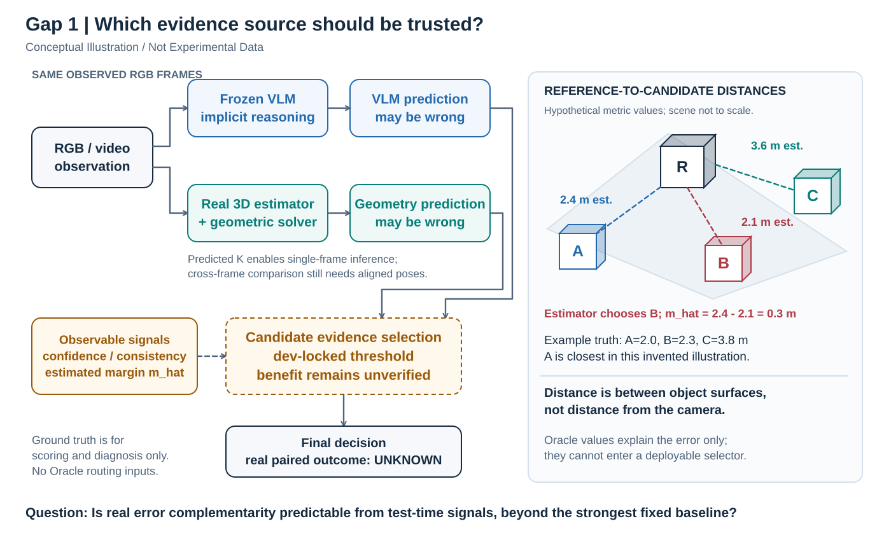
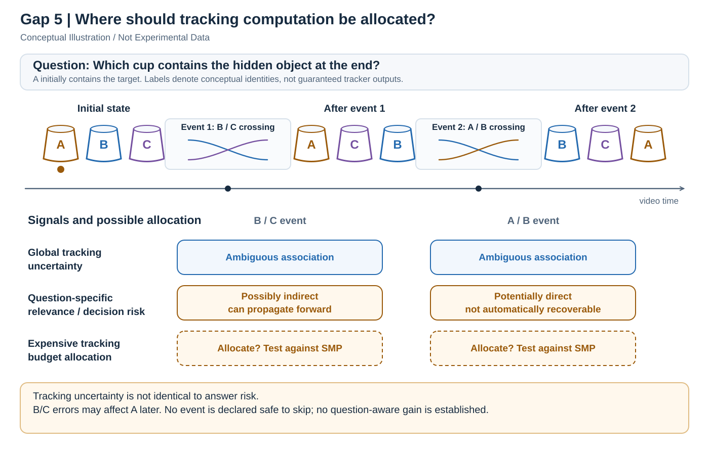
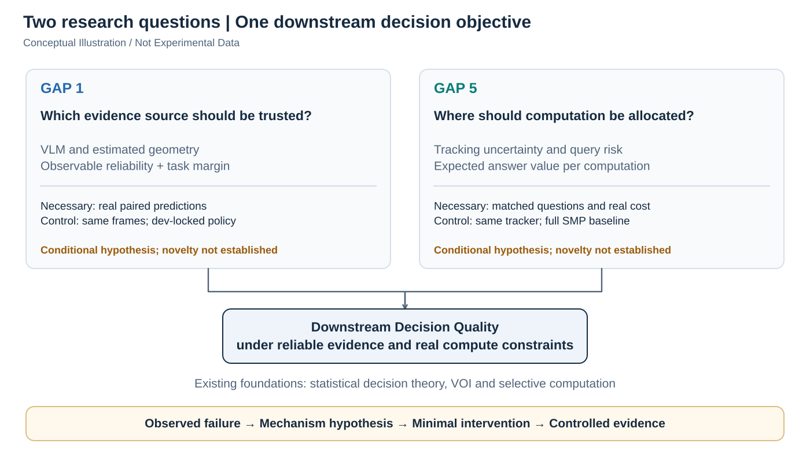

# Two Research Directions in Agentic Visual Reasoning
### Reliable Geometric Evidence & Question-Aware Visual Tracking

本文是 **Research Idea Explanation**：解释两个有条件成立的候选问题，不是完成的论文、实验结果报告或投稿声明。下文分别标记已有研究、本地事实与待验证假设；所有图均为 **Conceptual Illustration / Not Experimental Data**。

核心问题是：额外信息或计算何时能改善最终判断？Agent 调用工具并不自动带来收益；工具必须提供可靠、相关且值得其成本的证据。这一出发点属于既有决策理论，而非本文提出的新原则。

## Part I. Gap 1 — Reliability-Aware Geometric Reasoning

**When Should a Visual Reasoning Agent Trust Estimated Geometry?**

### A. Background：从像素判断到显式几何

VLM 可以识别物体并理解语言，却未必能从透视图像恢复准确的尺度、三维距离和参考系。遮挡、多实例名称以及跨视角的同一物体绑定，还会使语义正确的描述产生几何错误。

Implicit Visual Reasoning 直接让冻结 VLM 根据 RGB/video 回答；Tool-Augmented Geometric Reasoning 则用 3D detection 或 depth estimation 获取几何，再由确定性程序计算。后者把度量运算移出语言模型，但准确的公式也可能忠实放大错误的物体、尺寸或位姿输入。

本项目的 [ReVSI](https://github.com/3dlg-hcvc/revsi) closest-object 问题是：“哪个候选物体距离指定 reference object 最近？”**不是哪个物体距离摄像头最近。** 令参考物体为 $R$，候选类别 $i$ 的实例集合为 $\mathcal I_i$，则比较

$$
D_i=\min_{j\in\mathcal I_i}d_{\mathrm{surf}}(R,O_{ij}),\qquad y=\arg\min_i D_i.
$$

这里 $d_{\mathrm{surf}}$ 是物体间最短 surface-to-surface distance，按基准规则处理重叠；同名多实例取最小距离。2D 中心距、camera depth 或单个实例盒子的中心距均不能替代该任务。

### B. Core Problem：什么误差真正改变答案？

**Decision-relevant geometric error** 是足以改变选项排序的误差，而非任何坐标偏差。设最近与次近距离的 margin 为

$$
m=D_{(2)}-D_{(1)}.
$$

若 $\widehat D_i=D_i+\epsilon_i$，最近两者的估计差为 $m+\epsilon_{(2)}-\epsilon_{(1)}$。在每个距离误差绝对值都不超过 $\varepsilon$ 的简化条件下，$m>2\varepsilon$ 足以保证最近选项不翻转。这只是已有排序稳定性思想，**margin 本身不是贡献**。

真实误差还会相关：共享位姿偏差可能同时影响多个盒子。相关性不必然有害——共同刚体变换保持距离，共同正尺度也保持排序；差异性形变、实例绑错或不一致的跨帧位姿才可能翻转关系。不能用单个检测器的平均定位误差推断逐题决策风险。

**Prediction complementarity** 指两路在不同题目上各有正确者；**reliability signal** 则要在测试时预测哪路更可信。检测置信度、跨帧一致性与估计 margin $\widehat m$ 都只是候选信号，不是已校准正确率。Calibration 要检查分数与实际正确频率是否相符；高置信、大 margin 仍可能来自一致的错误。GT margin $m$ 只能用于事后诊断，不能用于部署路由。

### C. Central Hypothesis：可利用的条件性互补性

**待验证假设：冻结 VLM 与真实几何估计器，在部分空间关系任务上可能具有可由观测信号预测的逐样本互补性。** 这要求两路确实各能纠正对方的一些错误；测试时信号能识别这些条件；若要进一步主张新方法的必要性，还必须证明固定方法及常规 selective prediction 尚未解决问题。

令两路正确性为 $c_V,c_G\in\{0,1\}$。GT Oracle chooser 的正确率 $\mathbb E[\max(c_V,c_G)]$ 仅是诊断上界；只有部署策略在 scene-disjoint holdout 上超过 **dev 选定的最强固定基线**，才支持可利用性。Oracle uplift 大并不保证可学习、可校准的路由存在。

### D. Illustrative Example：表面距离排序可能翻转

图中假想真实距离为 A=2.0 m、B=2.3 m、C=3.8 m，真实最近者是 A；工具估计为 2.4、2.1、3.6 m，反而选择 B。估计 margin 为 0.3 m，不能据此断言工具可靠。数值仅解释排序翻转，未用于实验、阈值选择或效果估计；VLM 是否在此类真实样本上答对仍未知。

### E. Existing Work & Novelty Boundary

[Seeing Is Not Measuring](https://arxiv.org/abs/2609.29073) 已将 Qwen3.5-4B 与真实几何检测、深度和确定性求解器结合，并用不同检测后端与 GT Oracle 分解误差。其任务间结果表明真实几何输入可能帮助，也可能限制收益；“工具误差会伤害推理”已有证据。论文使用 GT boxes 选择 best view，且视觉基线与工具分支帧数不同，因此其汇总结果不能直接证明本项目所需的同输入、无 Oracle 路由效果。

[Geometrically-Constrained Agent for Spatial Reasoning](https://arxiv.org/abs/2511.22659) 将语义解析得到的任务约束与受约束的工具计算衔接，关注参考系、目标形式化及几何有效的执行。它说明问题不只在感知精度，也在语义到几何的计划是否正确；当前问题则进一步问：面对不可靠的真实估计，何时值得采用其判断？这一区分并不构成已验证 novelty。

[WildDet3D](https://github.com/allenai/WildDet3D) 是已有的 promptable 3D estimator，不是本项目的新模型。其 predicted intrinsics 支持单帧推理，但不会自动提供跨帧外参。更广泛的可靠性研究已有 [SelectiveNet](https://proceedings.mlr.press/v97/geifman19a.html) 等 selective prediction 工作；[On Calibration of Modern Neural Networks](https://proceedings.mlr.press/v70/guo17a.html) 也区分了模型置信度与真实正确概率。拒答与两专家路由不完全相同，但 confidence threshold、risk–coverage 和 calibration 都必须作为已有基础及对照，而非重新命名的贡献。

**Possible Difference** 是对真实估计误差、任务边界与逐题互补性的受控刻画，及测试时信号能否解释这种互补性。**Verified Novelty：尚未建立。** 潜在产出也可以是负结果或清晰的适用边界，不预设需要新架构。

### F. Falsification Conditions

若两路几乎共享所有错误，Oracle uplift 很小，互补前提就弱；若互补存在却无法由观测信号预测，可部署路由仍不成立。若简单 confidence threshold 已达到同等效果，它可能支持互补性的可利用性，却削弱提出复杂新方法的必要性，不能把这两种结论混为一谈。

若真实 estimator 持续失败，当前组合可能不适用；这不等于所有几何工具均无价值。若收益来自额外帧、GT best-view、额外传感器或更大计算预算，比较不能归因于可靠性机制。必要证据是同题、同 RGB 帧的真实 paired inference，完整失败日志、dev 冻结的策略、scene-cluster bootstrap，以及 GT 仅参与的事后边界诊断。

### G. Current Research Status

**本地事实（审计快照：2026-10-21）**：Stage 0 为 BLOCKED；Stage 0.5 在预选的 3 个场景取得标定，48 帧中 39 帧通过预写定检查、9 帧 INCONCLUSIVE。三个场景都没有达到 16 帧全通过，其余 52 场景未验证。**39/48 是帧对齐检查结果，不是 question-level success rate。**

当前候选子集是 132 道 closest-object questions / 55 scenes，属于论文 215 道 relative-distance 题的 closest 部分，另有 83 道 farthest。没有真实 VLM–Geometry paired inference，协议仍为未锁定草案。执行状态保持 **BLOCKED**；科学假设仍 **INCONCLUSIVE**，两者不互相替代。

## Part II. Gap 5 — Question-Aware Tracking Budget Allocation

**When Does Better Tracking Actually Improve Video Reasoning?**

### A. Background：身份正确不一定等于答案正确

Multi-Object Tracking（MOT）需要把逐帧检测关联为持续轨迹；Data Association 决定当前检测属于哪个已有身份。相似外观、交叉和遮挡可能引发 Identity Switch。Tracking uncertainty 表示关联尚不确定；昂贵的 Video Object Segmentation（VOS）可通过像素掩码传播补充证据，但代价更高，也不能保证恢复完全不可辨识的身份。

MOT 评价全局身份与轨迹质量，VideoQA 则评价某个问题的答案。一个不涉及目标事件的身份交换可能降低 MOT 指标而不改变答案；反过来，一个关键身份错误可能只影响少量轨迹，却使问答完全错误。这是目标函数的区别，不是“tracking 不重要”。

### B. Core Intuition：两个交叉是否同样值得处理？

设杯子 A 初始藏有目标。事件 1 是 B/C 交叉，事件 2 是 A/B 交叉；问题为“Which cup contains the hidden object at the end?” 两者都可能造成 tracking error，但与目标身份的联系可能不同。事件 2 更直接涉及 A，事件 1 也可能经后续关联污染 B，再影响对 A 的绑定。**不能预先断言 B/C 不重要，或直接规定跳过它。**

若三杯始终相互作用、所有身份都关键，question conditioning 可能没有额外价值。因此 shell game 应保留为负对照；更有辨别力的证据来自同一视频中、关注不同对象或事件的多个问题，而非仅改写措辞。

### C. Fundamental Distinction

**Tracking Uncertainty ≠ Question-specific Decision Risk。** 前者问“关联有多不确定”，后者问“某个身份错误会以多大概率改变最终答案，并产生多大损失”。高不确定性未必高答案风险；低频却关键的错误也可能具有高决策风险。两者可能高度相关，以至于后者并不能提供额外有效信号——这正是待检验之处。

### D. Theoretical Framework：计算作为动作

用 belief state $b$ 表示对身份、位置和事件关系的概率信念。对固定问题 $q$，可将 $R(b)$ 定义为在该信念下选择答案所能达到的最小 expected decision loss；动作 $a$ 是额外 mask propagation、轨迹重检或计算，而不是移动杯子的物理动作。

$$
\operatorname{VOI}(a)=R(b)-\mathbb E[R(b'\mid a)]-\lambda C(a).
$$

期望覆盖计算后可能获得的不同证据，$b'$ 是更新后的 belief，$C(a)$ 为成本，$\lambda$ 表示代价权衡。某次计算即使减小身份熵，也可能不降低问题的答案损失。有限预算下要比较可行计算动作的预期价值，同时计入估计 VOI 本身的开销。

这是 Value of Information / Value of Computation 与 resource-bounded metareasoning 的既有框架；[Russell 与 Wefald 的工作](https://doi.org/10.1016/0004-3702%2891%2990015-C) 已从决策效用讨论计算动作。公式在这里用于解释问题，**不是新算法，也不说明真实风险已经可估计**。

### E. Closest Competition：高度重叠，而非空白领域

[Selective Mask Propagation for Multi-Object Tracking（SMP）](https://arxiv.org/abs/2606.13033v3) 已让轻量 tracker 持续运行，在 assignment ambiguity 信号触发的窗口选择昂贵 mask propagation；仅在 VOS 的可靠证据反驳基础身份关联时修正输出，不确定时保留原结果。[公开实现](https://github.com/holma91/selective-mask-propagation) 的 assignment margin、窗口与身份恢复逻辑是直接强竞争者。

因此“在高风险时刻调用昂贵 tracker”不能作为新意。**Possible Difference** 仅在于用 question-conditioned downstream answer risk 分配同一计算资源，而非主要优化 MOT identity preservation。目标不同不代表最优策略必然不同：若 margin 已包含所有相关信息，SMP 就可能足够。

相邻研究也需区分：[AdaFrame](https://arxiv.org/abs/1811.12432) 已研究按输入选择视频帧及预测继续观察的效用，但不是身份恢复式 tracking；[CLEVRER](https://arxiv.org/abs/1910.01442) 用对象事件与不同类型问题研究视频推理，但不是 SMP 的同预算比较。它们分别提供 adaptive computation 与 object-centric VideoQA 背景，不能拿来冒充当前假设的实验证据。

**Track, Then Bind** 的指定标题涉及遮挡与包含下的对象身份推理，可能有明显重叠。但本轮在当前项目及检索到的本地 PDF 文件名中未找到可读取原稿，现有任务说明只将其标为 Yang Di 的 draft；未核实其方法、结果或公开实现。因此不据标题补写贡献，也不作排他性 novelty 判断。**Verified Novelty：同样未建立。**

### F. Failure Conditions：何时没有必要加入 question awareness？

以下证据会削弱当前方向：assignment margin 已足以预测 QA-critical failures；所有候选身份同样重要；relevance 只能从 GT 或最终答案得到；完全遮挡造成观测不可辨识，额外计算无从恢复；或 question-aware 策略在相同真实成本下不能超过完整 SMP 等强基线。

公平比较应固定 detector、ReID、tracker、VOS、QA reader 与问题集，保留强基线的恢复能力。必须同时记录 GPU-seconds 与端到端 wallclock，计入 query understanding、解码、关联、传播及 QA。多问题共享轨迹时，SMP 可复用一次全局计算，不能重复向其每题收取全额成本；否则“预算优势”可能只是计费错误。

### G. Current Status

Gap 5 只有可行性审计，尚无真实配对比较。已检查的 SMP SportsMOT demo 使用缓存轨迹并报告 MOT 指标，没有直接支持公平 VideoQA 的标注；VET cup/card 当前每视频一个问题也不足以单独检验 query 相关性变化。尚无证据表明 Question-aware Policy 优于 Tracking-aware Policy，不据此声称可投稿的方法贡献。

## Part III. Comparison & Shared Research Philosophy

| 比较项 | Gap 1 | Gap 5 |
|---|---|---|
| Research problem | 何时信任估计几何而非 VLM？ | 何处追加 tracking 计算？ |
| Mathematical foundation | 排序稳定性、条件风险、calibration | VOI、belief update、有限预算决策 |
| Existing methods | 几何工具链、约束规划、selective prediction | MOT/VOS、SMP、adaptive computation |
| Potential contribution | 真实互补性与可靠性信号的适用边界 | question risk 是否改变 QA–compute 前沿 |
| Strongest overlap | Seeing Is Not Measuring、GCA、置信选择 | SMP 的选择性传播与身份恢复 |
| Necessary evidence | 同输入 paired 预测、dev 锁定、scene CI | 同视频多问题、同工具、实际同预算比较 |
| Major logical risk | 把 Oracle 互补性当可部署增益 | 把目标差异当策略必然不同 |
| Current validation status | 执行 BLOCKED；假设 INCONCLUSIVE | 仅可行性审计；无优势证据 |

**Additional information or computation is not automatically useful; its value depends on reliability, relevance, and downstream decisions.** 这是 Statistical Decision Theory、VOI 和 Selective Computation 的共同基础，不是本文的新研究发现。

采用的研究路径是 **Observed Failure → Mechanism Hypothesis → Minimal Intervention → Controlled Evidence**。先把观察到的错误与可能机制分开，再用最小对照检验机制是否必要；缺数据、对齐或可观测信号时，先解决证据条件。若简单基线足够，就如实停止复杂方法开发；若互补性或相关性确有独立作用，再讨论贡献。失败、负结果和执行阻塞都有信息价值，但它们回答的是不同问题。

---

**资料边界与本地来源。** 状态来自 `reports/stage0_feasibility.md`、`reports/stage05_alignment_audit.md`、`reports/gap1_pilot.md`、`reports/gap5_feasibility.md`、`results/protocol_draft.yaml` 和 `results/stage05/go_no_go.json`；本轮均已读取。这里的路径是原实验项目的来源说明，不是要求 GitHub 读者访问本地磁盘。Stage 0.5 来源提交为 `9508c0b6d42a041aff9ea27792b9023897b5a79d`。文中公共链接指向论文或作者代码；未读取的 draft 不列为已核实文献。三幅图和所有示例不含真实实验效果数据。
